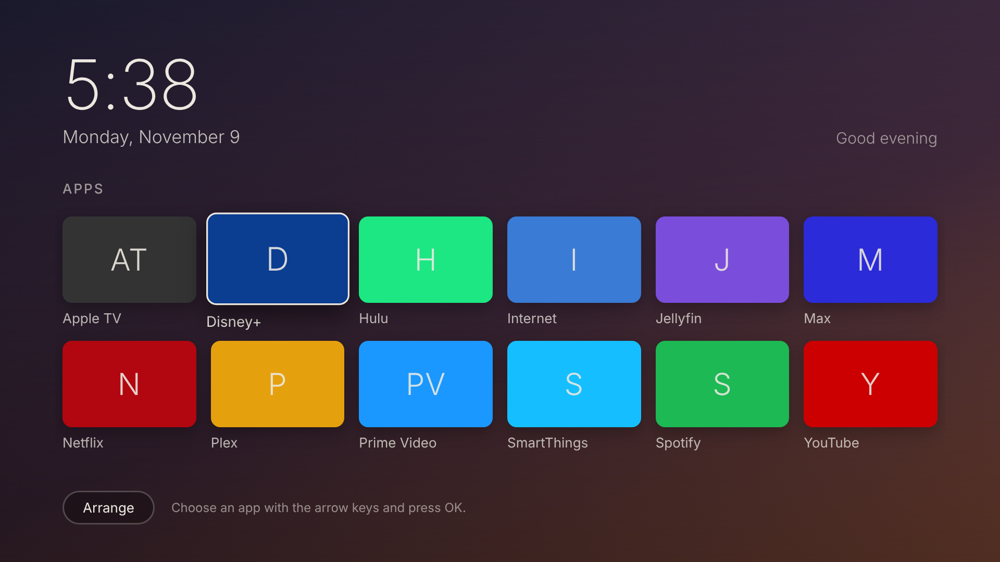

# NIfty

A quiet, ad-free home screen for Samsung smart TVs, plus a guide to removing
the bloat. It shows a clock and your apps, nothing else, and works with
the arrow keys and OK on the standard Samsung remote.

The idea comes from [CleanFrame](https://github.com/nthnclrk/cleanframe),
which is a home screen for Samsung's The Frame. NIfty is a separate, simpler
app meant for any Samsung Tizen TV from 2019 or later (Tizen 5.0+), including
the regular 4K QLED/Crystal UHD models.



## First, what's possible

Samsung TVs run Samsung's **Tizen** operating system. Samsung signs the
firmware and the TV checks that signature, so **you can't wipe it and install
a different OS** the way you can on a PC. Anyone who claims otherwise is
offering a firmware hack that risks bricking the TV and voids the warranty.

What you *can* do, in order of effort:

| Step | What you get | Effort |
|---|---|---|
| [1. Declutter the settings](docs/1-declutter-settings.md) | Turns off ad tracking (ACR), personalised ads, autoplaying previews and Samsung TV Plus at power-on | 10 min, remote only |
| [2. Block ads on your network](docs/2-network-blocking.md) | Blocks most remaining ads and telemetry, using NextDNS / Pi-hole | 15–30 min |
| [3. Install the NIfty home screen](docs/3-install-home-screen.md) | Your own home screen: clock and your apps, no ads, no promoted rows | ~1 hour the first time |

Steps 1 and 2 do most of the work. Step 3 replaces Samsung's cluttered home
screen with your own.

> **Simplest option of all:** plug in a streaming box (Apple TV, Nvidia Shield
> with a custom launcher, etc.), disconnect the TV from Wi-Fi, and use the TV
> only as a screen.

## The home screen app

```
app/
  config.xml   Tizen app manifest (IDs are filled in at build time)
  index.html   page layout
  device.js    the only file that uses the TV's Tizen API (has a fake mode for the browser)
  main.js      grid, remote-control navigation, Arrange mode, clock
  style.css    1920x1080 TV layout
scripts/
  preview.sh   preview in a desktop browser, no TV needed
  build.sh     build and sign dist/NIfty.wgt using Tizen Studio
  install.sh   install and open it on the TV
network/
  samsung-blocklist.txt   DNS blocklist for Pi-hole / AdGuard Home
```

Features:
- Lists all apps installed on the TV and opens them with OK.
- **Arrange** mode: move apps, hide apps. Samsung TV Plus, Gaming Hub and
  similar promo apps start hidden.
- Layout is saved on the TV. Newly installed apps show up automatically.
- Large clock and date, and a background that changes with the time of day.
- No network requests, analytics or ads. It never connects to the internet.

### Try it on your computer first

```bash
./scripts/preview.sh
# open http://localhost:4800 in a browser. Use the arrow keys, Enter = OK, Esc = Back
```

The preview uses a fake list of apps.

### Put it on the TV

Follow [docs/3-install-home-screen.md](docs/3-install-home-screen.md). In short:

```bash
mkdir -p .local && cp tv.env.example .local/tv.env   # then edit it
./scripts/build.sh
./scripts/install.sh
```

### Customise it

- Colours and sizes: `app/style.css` (`.sky-*` are the backgrounds).
- Number of columns: `COLS` in `app/main.js` and the `.tile` width in `style.css`.
- Apps hidden by default: `DEFAULT_HIDDEN` in `app/device.js`. This only
  applies the first time NIfty starts.
- Keep the code ES5 (no `let`/arrow functions) so it runs on older TVs.

## Disclaimer

This project isn't affiliated with Samsung. Sideloading uses Samsung's
official Developer Mode and doesn't change the TV's firmware. To remove it,
delete the app or factory-reset the TV. Use at your own risk.

MIT licence.
